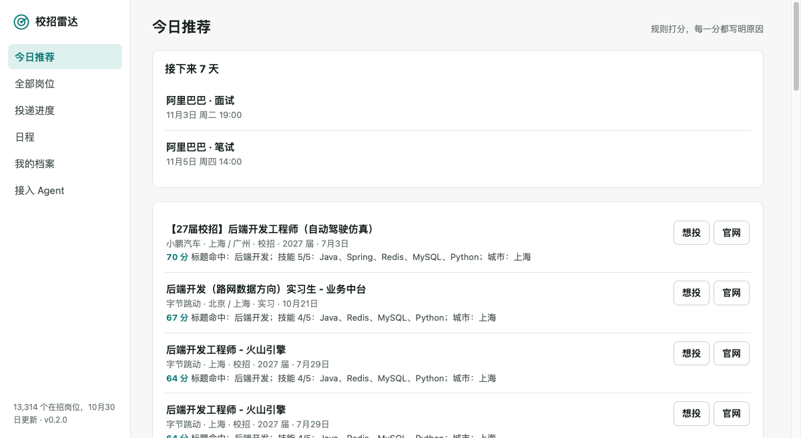
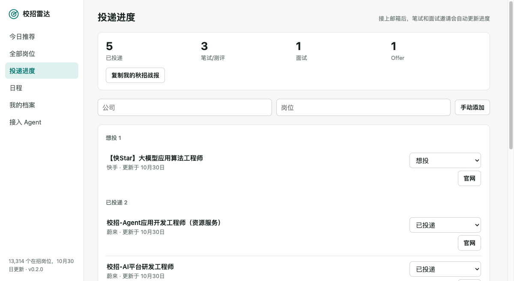

# 校招雷达

**每天告诉你今天该投什么、什么快截止、哪封邮件是面试邀请。**

开源的校招求职 agent。岗位直接来自公司校招官网，所有数据留在你自己的电脑上，也可以接进 Claude Code、Codex、OpenClaw 等任何支持 MCP 的 Agent。



<sub>截图使用示例档案。</sub>

## 为什么做这个

秋招最头疼的往往不是没有岗位，而是信息散在几十个官网、公众号和群里，岗位过期了不知道，笔试时间混在邮箱里，投了什么自己也记不清。

通用 Agent 每次现上网搜，校招信息会漏、会重、会过期。校招雷达把这件具体的事做完整：

- **岗位来自官网**：17 家公司，1.3 万多个在招岗位，每天更新，自动下线已关闭的岗位
- **推荐说得出理由**：按你的方向、技能和城市打分，每一分都写明来由，不调用大模型
- **投递不用记**：网页或插件一键记录，接上邮箱后笔试、面试邀请和拒信自动更新进度
- **不错过时间**：笔试面试进日历，提前 1 天和 1 小时提醒，每天推送到微信
- **不替你投递**：只帮你找和记，提交永远由你在官网完成，不碰账号，也不用担心被封

## 开始使用

**Docker**（推荐）：

```bash
curl -fsSL https://raw.githubusercontent.com/Ajax-1/campus-radar/main/docker-compose.yml -o docker-compose.yml
docker compose up -d
```

**macOS、Linux 一键安装**（需要 [Java 21+](https://adoptium.net/)）：

```bash
curl -fsSL https://raw.githubusercontent.com/Ajax-1/campus-radar/main/install.sh | sh -s -- --autostart
```

**Windows**：安装 Java 21 后，从 [Releases](https://github.com/Ajax-1/campus-radar/releases) 下载 `campus-radar.jar`，运行 `java -jar campus-radar.jar`。

然后打开 <http://localhost:8090>，填上方向和技能就能看到推荐。第一次启动会采集一轮官网，约十几分钟，期间可以边用边等。

## 接入你的 Agent

服务运行后，一条命令接入：

```bash
claude mcp add --transport http campus-radar http://127.0.0.1:8090/mcp
```

```bash
codex mcp add campus-radar --url http://127.0.0.1:8090/mcp
```

其他客户端在 MCP 配置里填 `http://127.0.0.1:8090/mcp`，传输方式 Streamable HTTP。

再装上技能，Agent 就知道怎么陪你走完求职全程，包括**按 JD 改简历**。它只重组你已有的经历，不编造项目和数字，改动逐条列出依据，拿不准的地方会先问你：

```bash
npx skills add Ajax-1/campus-radar
```

接好之后可以直接说：

> 这是我的简历，帮我建好档案，看看今天有什么适合我的岗位

> 我投了字节那个后端岗，记一下

> 这周有哪些笔试面试？

> 按这个 JD 改一下我的简历

| 工具 | 作用 |
| --- | --- |
| `search_jobs` `get_job` `list_sources` | 检索岗位、查看完整 JD、查看数据新鲜度 |
| `get_profile` `update_profile` `match_jobs` | 求职档案和打分推荐 |
| `record_application` `update_application` `list_applications` | 投递台账 |
| `list_events` `add_event` `sync_mail` | 笔试面试日程和邮箱同步 |

## 推到微信

微信扫码登录 [Server酱](https://sct.ftqq.com)，复制 SendKey，配置后每天 7:30 收到今日推荐，笔试面试开始前收到提醒：

```bash
RADAR_SERVERCHAN_KEY=你的SendKey
```

Docker 写在 `docker-compose.yml` 里，一键安装的写在 `~/.campus-radar/env` 里。也支持企业微信和飞书群，见[使用指南](docs/guide.md#匹配与每日推送)。

## 更多功能



- [接邮箱](docs/guide.md#投递闭环邮箱--台账--日历--提醒)：IMAP 只读，支持 QQ、163、Gmail 和学校邮箱，能识别中英文的笔试、面试、测评、Offer 和拒信
- [订阅日历](docs/guide.md#投递闭环邮箱--台账--日历--提醒)：苹果、Google、Outlook 日历都可以
- [浏览器插件](docs/guide.md#投递闭环邮箱--台账--日历--提醒)：在网申页面一键填表，只填空字段，从不提交
- 人在海外：设置 `RADAR_DISPLAY_ZONE=America/New_York`，日程同时显示北京时间和当地时间
- [部署公开实例](docs/guide.md#自己部署公开实例)：多人共用的只读岗位库
- [岗位快照](docs/guide.md#岗位快照)：一处采集，所有实例共用

## 覆盖的公司

字节跳动、阿里巴巴、腾讯、美团、快手、百度、京东、拼多多、小鹏汽车、蔚来、Momenta、中科创达、影石 Insta360、面壁智能、德赛西威、拓竹科技、叠纸游戏。

没有你想要的公司？[提个 issue](https://github.com/Ajax-1/campus-radar/issues/new?template=company-request.yml)。公司用的是飞书招聘的话，加一行配置就能接入，见[贡献指南](CONTRIBUTING.md)。

## 隐私

- 服务默认只监听本机。档案、投递记录、邮件和日程都存在你自己的电脑上，没有任何上报
- 邮箱是只读的：不标记已读，不移动，不删除，只处理求职相关邮件
- 浏览器插件填写的个人信息只存在本机浏览器
- 配置令牌之前，服务只响应本机地址的请求，其他网页无法读取你的数据

## 采集边界

- 只采公司官网公开的校招和实习岗位，低频请求，每天一轮，保留原文链接，引导回官网投递
- 不破解加密接口，不绕过验证码和风控，不采集聚合平台整理的内容

岗位信息以官网为准。如果你代表某家公司，希望不被收录，请[提 issue](https://github.com/Ajax-1/campus-radar/issues)，我们会尽快处理。

## 技术

Spring Boot、Spring AI、MCP Streamable HTTP、H2，网页界面没有构建步骤，打包在一个 jar 里。设计思路见[使用指南](docs/guide.md#设计要点)。

## 许可证

[MIT](LICENSE)
